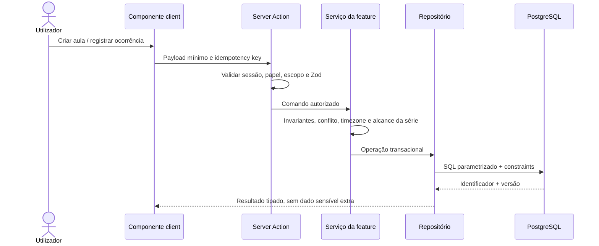

# Arquitetura e decisões

## Stack de execução

Next.js App Router 16.4.2, React 19.3, TypeScript, Tailwind CSS 4, Better Auth, PostgreSQL 17 + Drizzle, Zod e Pino. Web responsivo/PWA é o alvo inicial; build/dev usa Webpack por incompatibilidade observada dos bindings Turbopack no Windows.

## Módulos de código

```text
src/app/                         rotas, layouts, API auth, Server Actions finas
src/features/auth/               sessão e autorização de contexto
src/features/lessons/            serviço/repository, domínio de horários
src/features/subjects/           catálogo por estudante
src/features/recurrence/          regras, geração e exceções (próxima fase)
src/features/links/               convites, escopo e vínculo (fase docente)
src/features/study-records/       conteúdo, autoria, histórico (evolução)
src/components/                   primitives e casca visual
src/db/schema/                    schema tipado; sem query de produto em UI
src/lib/                           ambiente, i18n, logger, preferências
drizzle/                           migrations SQL sequenciais e verificáveis
docs/                              estratégia, decisões, UX, domínio, QA e operação
```

Regra de dependência: `app` → `feature service` → `repository` → `db`; UI → Server Action/route com validação e autorização. Repositório não determina permissão. Schema não conhece componentes. Integrações externas encapsuladas. Fluxos pesados em client somente no menor componente interativo necessário; consultas privadas não usam cache compartilhado entre requests.

## Fluxo seguro de escrita



Cada Server Action é endpoint acessível: autenticar e autorizar individualmente, nunca depender do esconder botão. Usar serialização explícita para propriedades client; erros públicos com código/ação, detalhes diagnósticos em log redigido. Mutações de série, convite, autorização e frequência exigem transação e idempotência.

## Multi-tenancy e privacidade

Modelo atual é owner por `student_id`. Toda leitura/escrita recebe `studentId` da sessão e filtra no banco; interface nunca escolhe owner. Etapa docente acrescenta `teacher_student_links` com consentimento e escopo; queries testam owner OU vínculo aceito + aula/matéria compartilhada. Avaliar Row Level Security no DB hospedado como defense-in-depth, mantendo checks de serviço. RLS sem contexto de sessão aplicado não substitui autorização da aplicação.

Segredos só em `.env.local`/gestor de segredos, nunca `NEXT_PUBLIC_*`. Pool server-only com limite e timeout; sem dados de aula em logs, analytics ou erros. Base local `.local/postgres-data/` e `.env.local` ignorados. Proteção contra CSRF/origins, rate limit e reset de senha antes de expor internet.

## Persistência

- PostgreSQL é fonte de verdade para usuário, matérias, séries, ocorrências e registros.
- Drizzle query builder parametriza SQL. Constraints/indexes formalizam invariantes e consultas de agenda; query plans só após dados/carga representativos.
- Migrations forward-only, pequenas, testadas em DB vazio e cópia de versão anterior. Backup/restore por ambiente; não fazer mudanças manuais que escapem do repositório.
- Tabelas sensíveis removidas via fluxo versionado/retention; retenção e eliminação dependem de política explícita.
- Schema implementado e lacunas: [`domain-model.md`](domain-model.md).

## Data, fuso e recorrência

Uma data de aula é calendário civil + timezone de regra; uma ocorrência realizada tem instantes UTC e snapshot local. DST exige política e testes específicos. Agenda lista por data local do perfil, sem reinterpretar uma aula já realizada. Série mantém identificador estável, regra versionada, ocorrências e overrides; janela de geração idempotente. Ver decisões e riscos em [`domain-model.md`](domain-model.md).

## Observabilidade e falhas

Log estruturado de código de erro, rota/feature, trace id, usuário pseudônimo quando aprovado, latência, versão de schema e retry; sem conteúdo acadêmico, e-mail, token de convite ou texto livre. Monitorar erros de gravação, migração, timeouts de pool, conflitos de série e entrega de lembrete. Consentimento/configuração de alertas antes de e-mail/push.

## ADRs

### ADR-001 — Web PWA primeiro

Escolher Next/React responsivo instalável no iOS/Android e navegável no desktop. Benefícios: compartilhar uma base, disponibilizar atualização simples, caminho sem App Store. Limites: instalação no iPhone exige Safari/HTTPS e a PWA não substitui toda API nativa; validação em dispositivo real ainda pendente. Revisar se uso offline/push/integrações exigirem Expo/nativo.

### ADR-002 — PostgreSQL relacional

Escolher PostgreSQL + Drizzle, consistente com relações de usuário, matéria, série, aula, participante e histórico; constraints e transações importantes para recorrência e escopo. Mongo não foi adotado.

### ADR-003 — Registros de presença por pessoa

Não usar um estado global “faltou aluno/professor” no produto compartilhado. O modelo alvo grava relato independente com autoria; status final pode ser derivado. A migration `0000` contém enum simplificado da primeira UI e precisa migração antes da colaboração.

### ADR-004 — Serviço separado de camada HTTP e repositório

Páginas/actions não contêm SQL de domínio. O repositório de `features/lessons` começou nessa fronteira; ao expandir dividir comandos/consultas de calendário, matérias e presença.

## Evolução e deployment

Local: banco privado isolado em porta 5433, URL via env. Nenhum banco hospedado/domínio/HTTPS público provisionado. Para release: CI inclui lint/tipos/testes/build/migrações; secrets de preview/prod separados; aplicar expand/backfill/contract, backup e rollback; health/readiness; observabilidade sem payload pessoal; plano de recuperação. `.local` contém estado de desenvolvimento e não é distribuição.
