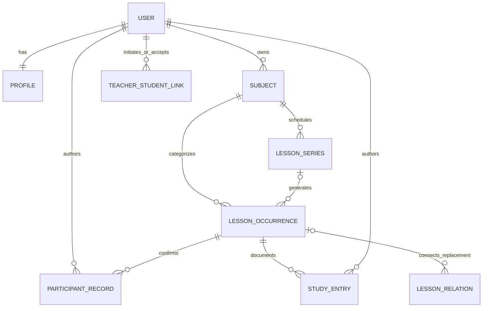

# Modelo de domínio

O schema SQL deve representar conceitos com identidade própria e preservar a fonte de cada registro. Este documento é o contrato alvo; as tabelas marcadas **proposta** ainda precisam virar migrations e endpoints antes de serem anunciadas como funcionais.

## Entidades e propriedade

| Entidade | Dono/escopo | Conteúdo e invariantes |
|---|---|---|
| Account (Better Auth) | Identidade | E-mail, senha protegida, sessões; não contém dados escolares de terceiros |
| Profile (proposta) | Uma conta | Nome de apresentação, papéis/contexto, timezone IANA, locale, preferência de calendário |
| Subject | Estudante | Nome, cor, descrição/objetivo, estado ativo/arquivado; nome pode repetir entre alunos |
| TeacherAvailability (proposta) | Professor | Intervalo indisponível/disponível, timezone, origem e validade |
| TeacherStudentLink (proposta) | Duas contas | pending/accepted/revoked/expired, scopes consentidos, solicitado/aceito/revogado em, token hash e expiração |
| LessonSeries | Estudante + matéria | Regra semanal/quinzenal limitada, horário local, timezone IANA, janela e dias; criação grava ocorrências numa transação |
| LessonOccurrence | Uma ocorrência real | Data civil, início/fim, FK opcional da série, conteúdo planeado e presença simplificada |
| ParticipantRecord (proposta) | Participante + ocorrência | Relato independente por aluno/docente: presente, ausente, justificado/não informado, autoria e data/hora; correção cria nova revisão |
| StudyEntry (proposta) | Autor + ocorrência | Conteúdo realizado, nota, visibilidade `private/shared`, editor e versões; separar rascunho do registro publicado |
| LearningObjective (proposta) | Matéria/aluno | Tópico/habilidade, origem, estado de revisão e ligação a aulas; sem inferência automática |
| LessonRelation (proposta) | Ocorrências relacionadas | reposição/substituição/cancelamento derivado; nunca apagar a origem |
| AuditEvent (proposta) | Escopo autorizado | eventos sensíveis sem payload escolar integral; ator, ação, entidade, momento e trace id |

## Modelo relacional resumido (alvo)

## Recorrência e horários

Armazenar a regra da série com biblioteca/parser RFC 5545 validado e versão explícita. Datas até um horizonte configurável viram ocorrências únicas (`series_id`, `original_local_date`, chave idempotente); janela mais distante pode ser calculada sem persistir. As regras suportam edição em escopo sem deslocar identificadores confirmados. Exceção move/cancela apenas uma ocorrência e conserva o horário originalmente gerado.

- `starts_at_local`/`ends_at_local` + `timezone` IANA expressam intenção da regra; `starts_at_utc`/`ends_at_utc` expressam o instante materializado.
- Aula avulsa também tem fuso explícito; não usar só `timestamp without time zone` como instante real.
- Fechar intervalo em `[início, fim)`; validação `fim > início`. Aulas imediatamente consecutivas não são overlap.
- Regras que caem no gap/fold de DST precisam de política explícita (pular/normalizar/perguntar), e evento já confirmado não muda automaticamente.
- Idempotência garante que reprocessar agenda/retentativa não cria duas ocorrências.

## Presença, autoria e histórico

Não armazenar um enum único com valores `student_absent` / `teacher_absent` como verdade compartilhada. São relatos individualizados: o aluno só registra sua presença; professor só registra a própria (admin de relação pode registrar nota, nunca em nome de outro). Ausência de relato não é ausência física. Uma apresentação consolidada é derivada dos dois registros, sem descartar a origem. Correção guarda autor, motivo e revisão anterior.

Separar **estado da aula** (planned/completed/cancelled/rescheduled) de **estado da participação** (unrecorded/present/absent/excused) e de **conteúdo estudado**. Isso evita contar aula cancelada como falta, contar presença sem a aula ocorrer e marcar tópico planejado como aprendido.

## Autorização e invariantes transacionais

- `student_id` e vínculo derivam da sessão, nunca do input do navegador.
- Toda query de objeto inclui owner/link/scope na cláusula (ID aleatório sozinho não é autorização).
- Professor só acessa vínculo aceito e scopes ativos; revogar invalida sessões de domínio relacionadas.
- Convites armazenam hash de token, têm validade e uso único; rate limit e resposta anti-enumeração.
- `lesson_occurrence` tem FK composta para matéria do mesmo estudante e FK para série dona; checks de intervalo e presença.
- `unique(series_id, original_local_date)` evita duplicata; índice `(student_id, starts_at_utc)` serve agenda; índice por participante/data atende professor; indexes cobrem FKs usados no join.
- Criar ocorrência e materializar vínculo da série em transação; conflitos podem usar advisory lock/unique constraint, com idempotency key no comando.
- Vínculo/escopo sensível é auditado; logs operacionais guardam code, trace id e latência, sem conteúdo de notas/e-mail/token.

## Modelo implementado hoje

`user`, `subjects(student_id, name, color)`, `lesson_series`, `lessons(student_id, subject_id, series_id, original_lesson_date, lesson_date, starts_at, ends_at, status, cancellation_reason, cancelled_at, is_exception, planned/studied_content, attendance, attendance_note, attendance_recorded_by/at)` e tabelas Better Auth; migrations `0000`–`0014`. Há criação de aulas avulsas e séries semanais/quinzenais (até 300 ocorrências, atomicidade, timezone da série) e autoria/hora do estado aluno.

**Estado da aula separado da presença (0008):** `status` é `planned` ou `cancelled`; cancelar guarda motivo e momento, nunca altera `attendance` e a aula cancelada não aceita registro de presença. Reativar volta a `planned`.

**Exceções e escopo de série (0008):** cada ocorrência de série guarda `original_lesson_date` (data gerada pela regra; único por série). Editar ou mover uma ocorrência com escopo **somente esta** marca `is_exception`. Os escopos **esta e as próximas** e **toda a série** alteram horário, matéria e conteúdo previsto (nunca a data) e, por cancelamento/exclusão, cancelam ou apagam ocorrências irmãs; ficam de fora ocorrências passadas (data civil no fuso da série), com presença registrada, canceladas ou exceções. "Toda a série" também atualiza a regra em `lesson_series`. Dividir a série em duas regras, feriados automáticos e restaurar padrão de uma exceção continuam propostos.

**Conflitos:** criar, editar e reativar verificam sobreposição `[início, fim)` com aulas `planned` do próprio aluno; o servidor devolve os conflitos e só grava com confirmação explícita (`allowConflicts`).

**Reposição (0009):** `lessons.replaces_lesson_id` liga a reposição à ocorrência original (FK composta com o mesmo aluno, no máximo uma reposição por aula). A original sem registro próprio fica cancelada com o motivo; uma original com falta já registrada mantém o registro. Uma original já reposta não pode ser reativada enquanto a reposição existir; excluir a original apenas desfaz a ligação.

**Vínculo professor ↔ aluno (0010–0011, implementado):** `teacher_links` (`pending/accepted/revoked`, hash SHA-256 do código, validade de 7 dias, uso único, quem revogou), `teacher_link_subjects` (escopo consentido por matéria, FK composta para matérias do próprio aluno), `participant_records` (relato do professor sobre a própria presença: `present/absent/excused`, único por aula e autor) e `audit_events` (ator, ação e vínculo, sem conteúdo escolar). Qualquer conta pode gerar convite em `/professor`; o aluno usa o código em `/vinculos`, vê o nome de quem pede e o que será partilhado, escolhe as matérias e aceita. Há no máximo um vínculo aceito por par; um segundo código só amplia o escopo. Qualquer parte revoga e o acesso termina na mesma transação. O professor vê só as aulas das matérias consentidas (datas, horários, conteúdo previsto, cancelamentos e o relato de presença do aluno; nunca o conteúdo estudado) e só escreve o próprio relato. O aluno vê o relato do professor ao lado do seu e a marca “Registros diferentes” quando relatou ausência do professor e o professor registrou presença.

`attendance_status` do aluno continua a ser o relato do aluno; “Relatei falta do professor” é auto-declaração do aluno, não dado do professor. Pendentes: resolução formal de divergência com nova revisão, objetivos de aprendizagem e notificações.

**Registro pós-aula (0013):** além do conteúdo estudado, cada aula guarda `private_note` e `next_step`, escritos só pelo aluno e nunca incluídos nas consultas do professor.

**Feriados e pausas:** o aluno escolhe um período e um motivo, vê quantas aulas serão afetadas e confirma. São canceladas apenas aulas `planned` sem registro de presença, de hoje em diante (no fuso do perfil, ou UTC); aulas passadas, com presença/falta ou já canceladas não mudam. Cancelamento não é falta. Uma reposição cancelada deixa de bloquear a reativação da original.

**Perfil (0014):** `profiles(user_id, time_zone)` guarda o fuso IANA da conta, editável em `/perfil`. Novas séries usam esse fuso em vez do informado pelo navegador; aulas já criadas mantêm data e hora civis.

**Limite de tentativas (0012):** contadores do Better Auth em PostgreSQL (`rate_limit`), ativos em todos os ambientes: login 10/min e cadastro 30/h por IP, 100/min nas demais rotas de auth; verificação e aceite de código de convite 10 por 15 min cada e criação de convites 20/dia por conta. O IP vem dos cabeçalhos do proxy: em produção, o app precisa estar atrás de um proxy que sobrescreva `x-forwarded-for`. Verificação de e-mail continua pendente porque depende de um provedor de envio.

## Evolução de schema sem perda

Nova migration em fases: expandir para colunas/tabelas novas; backfill de `student_absent`/`teacher_absent` em relato com autor conhecido quando viável (caso contrário, autoria `legacy/unknown`); dual write/read; verificar contagens e FKs; trocar consultas; somente então marcar enum legado deprecado. Não converter estado legado para relato certificado do professor sem evidência. Nunca reescrever migrations já aplicadas.
